# User guide

A tour of the NGH Investor Concierge prototype, page by page. Screenshots use the seeded demo data. Run the app with `npm run dev` (see the main [README](../README.md)).

## Sign in — `/login`

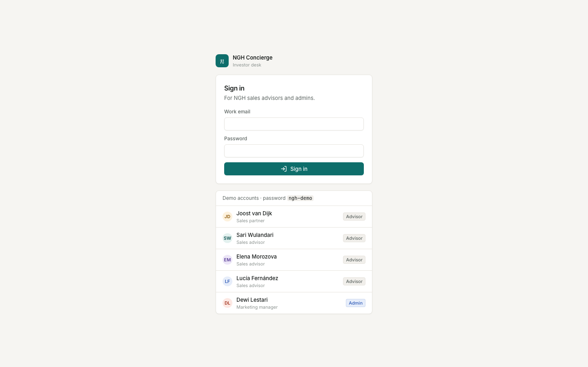

The workspace is for NGH staff only, so signed-out visitors are sent here. Sign in with a work email and password. The demo accounts all use the password `ngh-demo`; click one to fill the form. The investor-facing pages (`/widget` and `/brief/[id]`) don't need a sign-in.

Each account has a role:

| | Advisor | Admin |
| --- | --- | --- |
| Overview, Inbox, Pipeline, Leads, Follow-ups, Reports | ✓ | ✓ |
| Export a lead's data | ✓ | ✓ |
| Knowledge base and templates | Read only | Edit and approve |
| Delete a lead's data on request | | ✓ |
| Quality review | | ✓ |
| Settings (rules, routing, cost cap, compliance, audit log) | | ✓ |

In the demo, Joost, Sari, Elena and Lucía are advisors and Dewi (marketing manager) is the admin. Sign out with the icon next to your name at the bottom of the sidebar.

## Overview — `/`

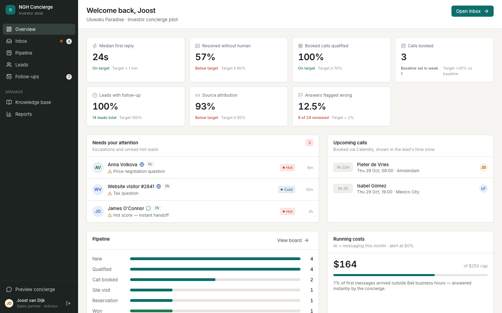

The landing page for advisors and the founder. The seven KPI tiles match the BRD's success metrics and compare live numbers with the 90-day targets: first reply, resolved without a human, booked calls qualified, calls booked, follow-up coverage, source attribution and answers flagged wrong in QA. Below them: leads needing attention (escalations and unread Hot leads), upcoming calls in the lead's time zone, the pipeline by stage, and running costs against the monthly cap.

## Inbox — `/inbox`

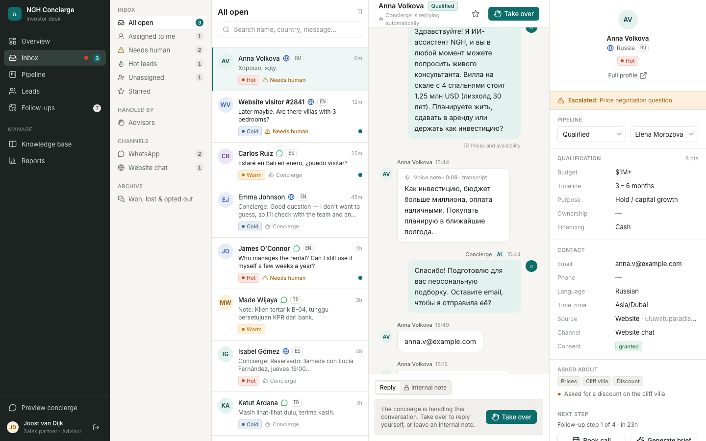

The advisor's daily workspace (FR-19).

- **Left:** views (all open, assigned to me, needs human, Hot, unassigned, starred), advisors and channels.
- **Middle:** the conversation. The concierge replies automatically until an advisor presses **Take over** (FR-13, FR-17). System events (scoring, routing, booking, escalation) appear inline. Voice notes appear with their transcript (FR-05). Use **Reply** to message the lead or **Internal note** for the team.
- **Right:** the handoff summary (FR-14): stage, assigned advisor, qualification answers and points, contact details, source, consent, topics asked about, objections and the next step.

## Concierge widget — `/widget`

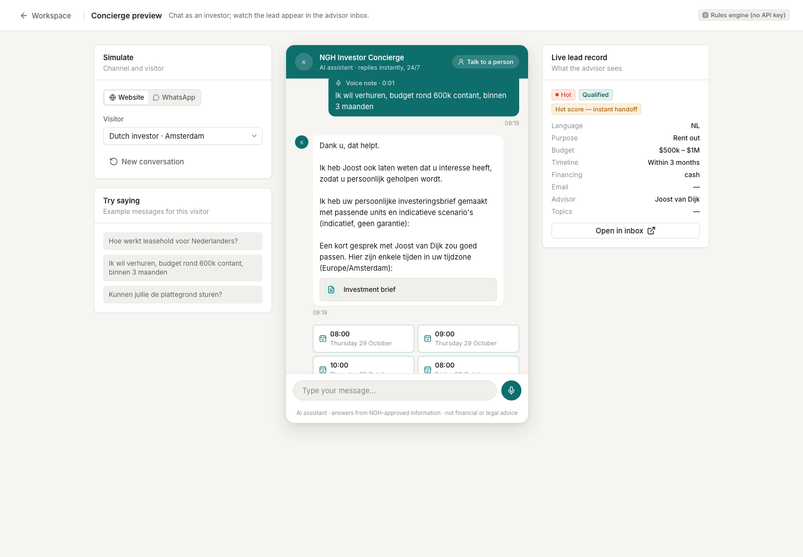

The investor-facing chat, used to demo and test the concierge. Pick a channel (Website or WhatsApp) and a visitor persona, agree to the privacy notice, then chat. The concierge introduces itself as NGH's AI assistant in the visitor's language, answers from the knowledge base, qualifies, shares assets, generates a brief and offers call slots. The **Live lead record** panel shows what the advisor sees. Open the Inbox in another tab to watch the lead appear.

- **Voice notes (FR-05):** with an empty message box, the button shows a microphone. Tap it, speak in the visitor's language, then tap the square to send. The browser transcribes the recording, and the concierge replies in text. The ✕ discards the recording. This needs a browser with speech recognition (Chrome, Edge or Safari) and microphone permission.
- **Call slots (FR-11):** slots are advisor hours in Bali (09:00–18:00 WITA) that also fall between 08:00 and 21:00 for the lead, shown in the lead's time zone.

The badge in the top right shows which engine is live: Claude (when `ANTHROPIC_API_KEY` is set) or the rules engine.

## Pipeline — `/pipeline`

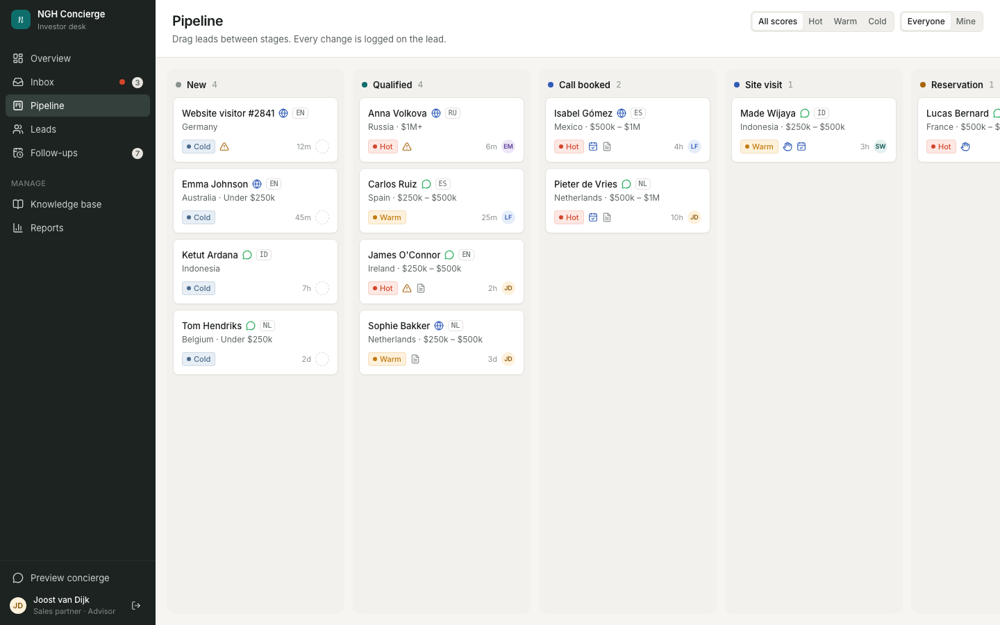

Drag-and-drop board with the BRD stages: New, Qualified, Call booked, Site visit, Reservation, Won, Lost (FR-18). Filter by owner (all or mine) and score. Moving a card to Lost asks for a reason, which feeds the weekly report.

## Leads — `/leads` and `/leads/[id]`

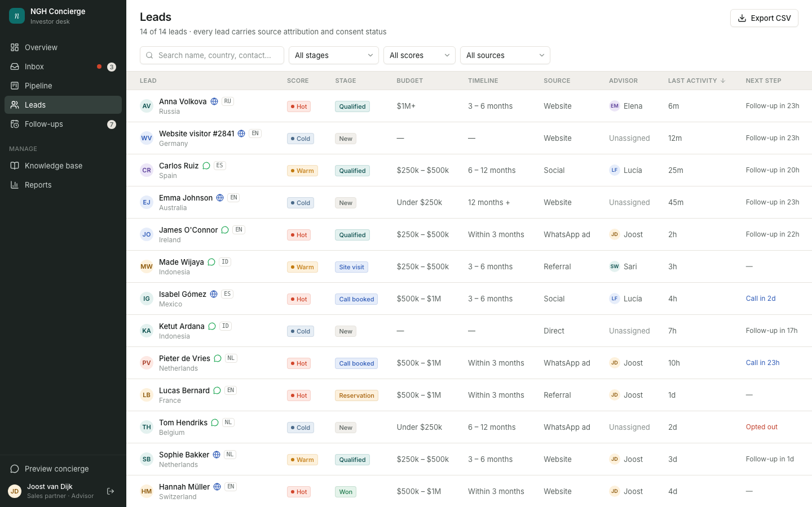

All leads with search and filters by stage, score and source.

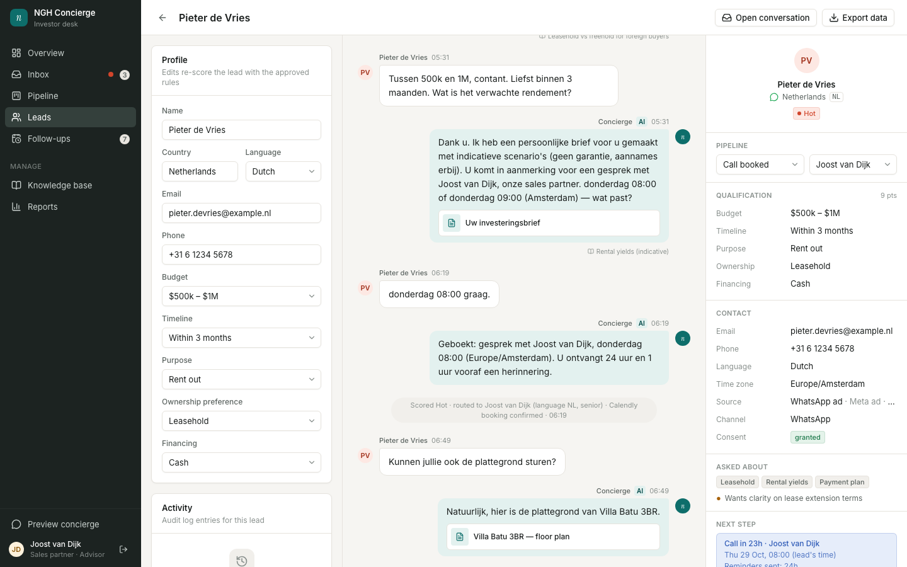

The lead profile holds the editable qualification fields (editing re-scores the lead with the approved rules), the full transcript, the activity log and the handoff summary. **Export data** covers PDP Law and GDPR access requests. Admins also see **Delete on request** for erasure requests.

## Investment brief — `/brief/[id]`

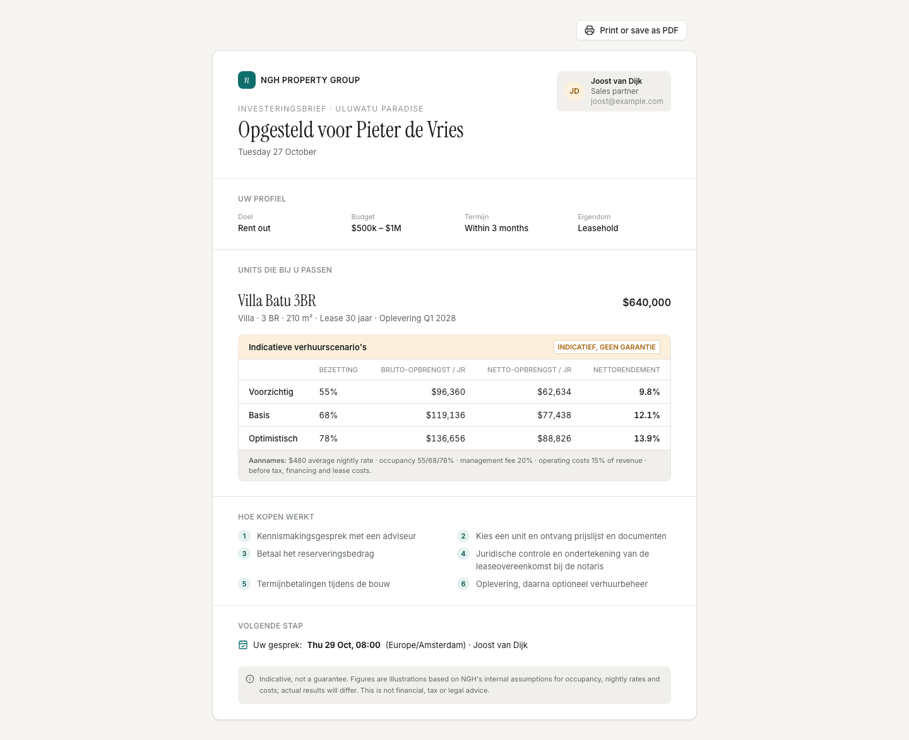

A 1–2 page brief generated once a lead is qualified (FR-09), written in the lead's language: profile, matching units, indicative rental scenarios with assumptions shown and the "indicative, not a guarantee" label (FR-10), the buying process and the booked call. **Print or save as PDF** produces the file to send.

## Follow-ups — `/follow-ups`

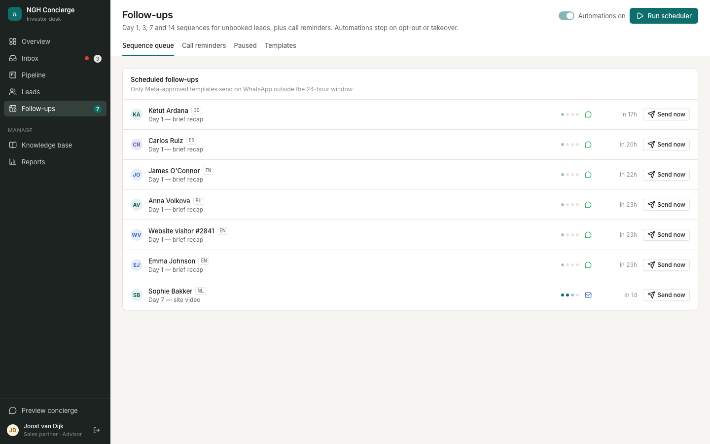

- **Sequence queue:** day 1, 3, 7 and 14 messages for unbooked leads (FR-15). **Send now** sends one immediately; **Run scheduler** processes everything due.
- **Call reminders:** 24 h and 1 h before each booked call (FR-16).
- **Paused:** leads whose automation stopped because they opted out, an advisor took over, or consent was withdrawn (FR-17).
- **Templates:** message copy per language and which ones Meta has approved. Only approved templates send on WhatsApp outside the 24-hour window. Admins edit templates and pause or resume all automations; advisors see them read-only.

## Knowledge base — `/knowledge`

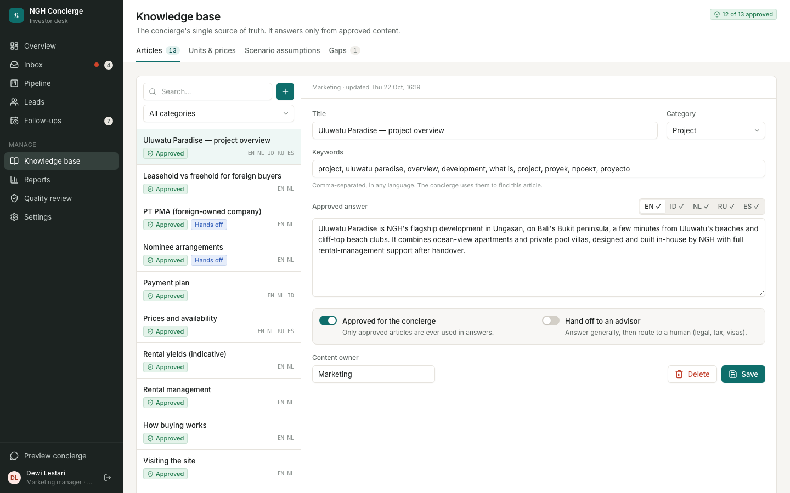

The single source of truth the concierge answers from (FR-03), editable by marketing without code. Articles carry translations per language and an approval status; only approved articles are used. Articles on legal or tax topics can be marked to escalate to an advisor. Also here: the unit list and prices, the scenario assumptions used in briefs, and **gaps** (questions the concierge couldn't answer) to turn into new articles.

Advisors can read everything but not change it:

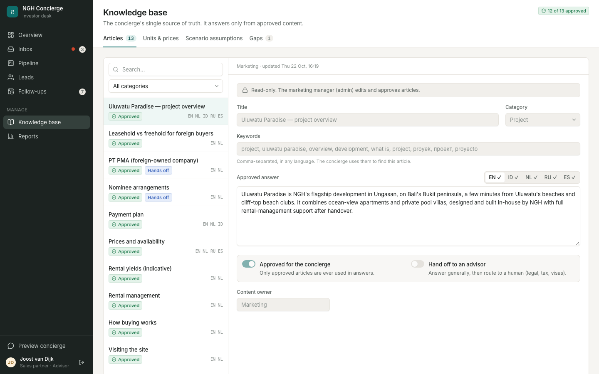

## Reports — `/reports`

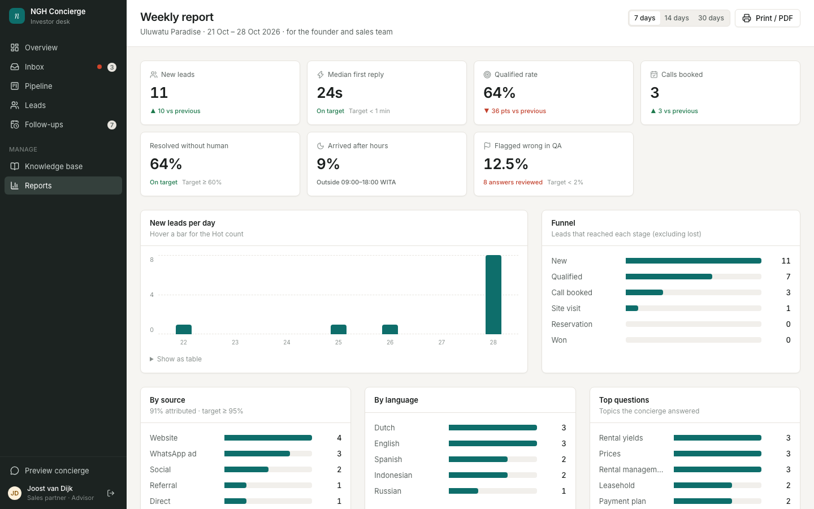

The weekly management report (FR-20): new leads, median first reply, qualified rate, calls booked, resolved without a human, after-hours share and answers flagged wrong in QA, compared with the previous period where it applies. Breakdowns by day, funnel stage, source, language, top questions, unanswered questions, lost reasons and advisor. Switch between 7, 14 and 30 days, and print to PDF.

## Quality review — `/qa` (admins)

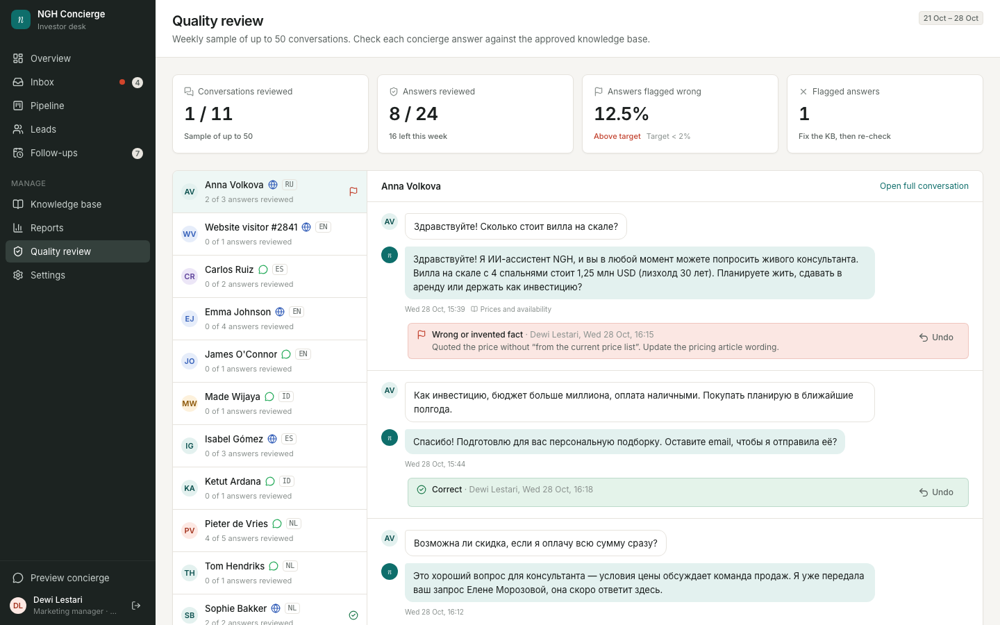

The weekly QA the BRD asks for (accuracy NFR). Each week the page samples up to 50 conversations that had concierge answers. For each answer, the reviewer sees the lead's question, the answer and the knowledge base articles it used, then marks it:

- **Correct**, or
- **Wrong**, with the issue (wrong or invented fact, should have handed off, off-brand tone, wrong language, other) and a note on what it should have said.

The tiles track progress and the **answers flagged wrong** rate against the < 2% target. **Flagged this week** lists every wrong answer so the knowledge base can be fixed. **Undo** clears a verdict. Template messages (follow-ups and reminders) are approved copy, so they aren't sampled.

## Settings — `/settings` (admins)

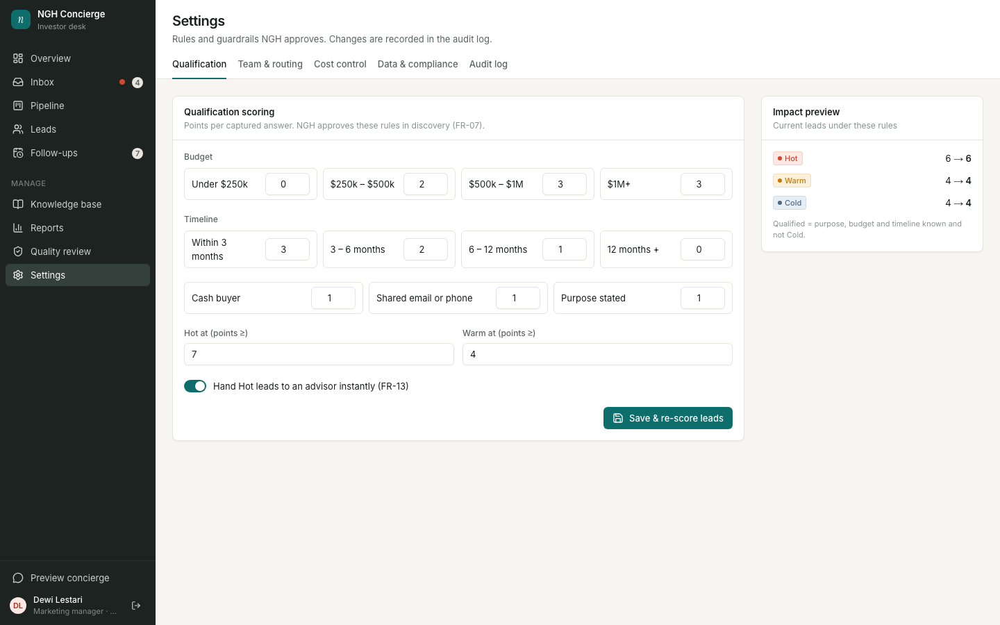

Rules and guardrails NGH approves. Every change is written to the audit log.

- **Qualification:** points per answer, Hot and Warm thresholds and instant handoff on Hot (FR-07, FR-13), with a preview of how current leads would re-score.
- **Team & routing:** advisors, the languages they cover, seniority (Hot leads go to senior advisors first) and open-lead load (FR-12).
- **Cost control:** monthly AI and messaging cap and alert threshold.
- **Data & compliance:** retention period, privacy notice link and demo data reset.
- **Audit log:** sign-ins, takeovers, handoffs, exports, deletions, QA flags and settings changes.

## Design system — `/design-system`

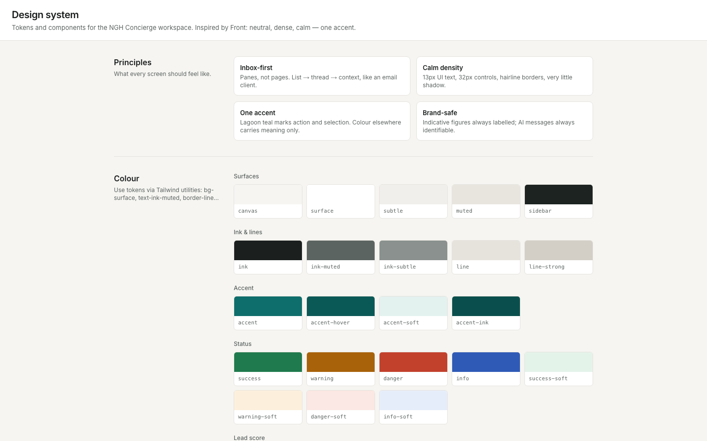

Colour, type and component reference for the calm, premium brand voice the BRD asks for.
